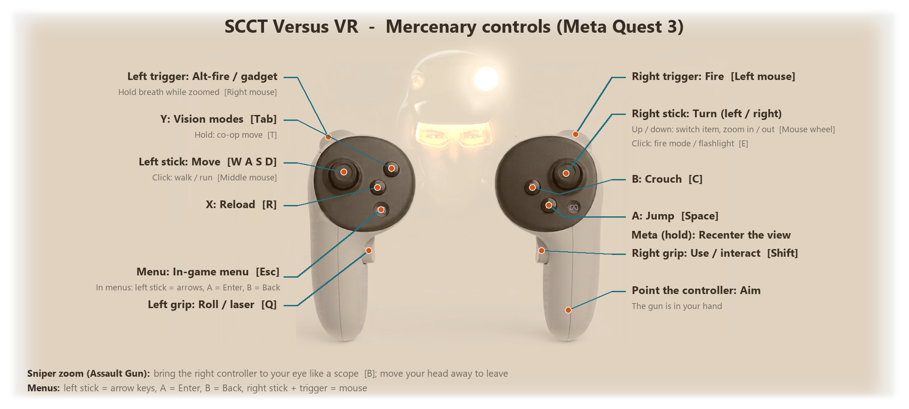
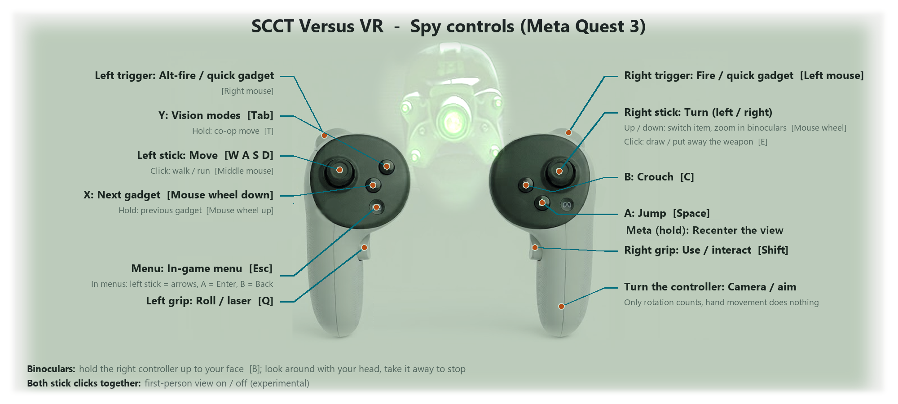

# SCCT Versus VR

[](https://www.youtube.com/watch?v=nbMLmVTR_hc)

An OpenXR VR mod for **Splinter Cell: Chaos Theory — Versus** (multiplayer), built on top of
**Enhanced SCCT Versus 3.6** and **SCCT Versus Reloaded 3.0a**.

**Tested on [Enhanced SCCT Versus v3.6](https://github.com/Joshhhuaaa/EnhancedSCCTVersus/releases/tag/v3.6)**
(includes SCCT Versus Reloaded 3.0a) — install that version first.

## Controls





Full controller layout for both teams (and menus, keyboard keys, remapping):
**[controls.txt](controls.txt)**

## About

It is a single proxy `d3d9.dll` that sits under Reloaded's Direct3D 8 → 9 layer and turns the
game into a stereo, head-tracked (6DoF) VR game, with motion-controller aiming, a separate HUD
layer and Quest/Touch controller input. No game file is patched; other players do not need the
mod.

Gameplay video: https://www.youtube.com/watch?v=nbMLmVTR_hc

For players: see [`USER_GUIDE.md`](USER_GUIDE.md) and [`controls.txt`](controls.txt).

---

## Status (v0.8.3)

Working (tested on Meta Quest 3 through Virtual Desktop, RTX 3090, online matches):

- Stereo rendering with 6DoF head tracking, recenter that waits for real tracking.
- Mercenary: aims with the right controller; the first-person weapon is drawn in the right hand.
- Mercenary reload by hand: bring the left hand to the gun's magazine.
- Mercenary zoom (Assault Gun sniper mode): put your eye to the gun to switch it on; the zoomed
  view is shown on a screen in front of the eyes, aiming like a mouse.
- Spy in third person: the right controller's rotation steers the camera and aims, the VR view
  stays steady behind the spy; binoculars with the same gesture, looking around with the head.
- Spy first-person view (both stick clicks) — **experimental**, see known issues.
- Dynamic lights, shadows and environment reflections stay fixed to the world; the skybox is
  rendered at infinity.
- Volumetric light shafts (e.g. the sunbeams in Warehouse) and the merc's flashlight cone seen
  from outside are in the right place in both eyes.
- Spy camouflage suit: the see-through effect works in VR.
- The PC window shows what the headset shows (the right eye, with the HUD where it is in VR),
  for streaming / people watching (`DesktopMirror`).
- HUD on its own OpenXR quad layer that follows the game camera, so objective markers sit on
  their targets; menus (main and in-game) on a flat virtual screen with menu controls.
- Quest/Touch controllers mapped to keyboard/mouse (configurable, separate spy and menu sets,
  hold bindings).
- Multiplayer: hosting and joining online sessions.

Known issues / limitations:

- **Looking behind you causes graphical glitches** (missing geometry, black areas): the game
  only draws what its own camera sees and culls everything else. Still being worked on (see
  roadmap).
- **Spy first-person view is experimental:** the game is not made for it — the view comes from
  the spy's head while the game still renders and culls from its third-person camera, so it can
  go wild (geometry popping near the head, walls when backed against them, odd moments while
  climbing).
- **Alternate-frame rendering (AFR):** each eye gets every second game frame, so the game should
  run at ~2× the headset refresh rate (`fps_merc` / `fps_spy` in `SCCT_Versus.config`).
- The HUD follows the weapon (needed for markers to line up) because the game camera follows the
  weapon.
- The game (not the mod) occasionally crashes when leaving a match (heap error in Reloaded /
  MSVCR70, also seen without VR).
- Standalone Quest version (WinlatorXR) is in progress and not released yet (see the Quest
  section). Its code is in the same DLL but only switches on inside WinlatorXR.

---

## Repository layout

```
src/            the mod (d3d9.dll proxy)
  dllmain.cpp     d3d9.dll exports, Direct3DCreate9 -> D3D9On12, ExitProcess hook, crash module log
  hooks.cpp       IDirect3DDevice9 vtable hooks: cameras, 2D/HUD routing, weapon, lights, dumps
  vr.cpp          OpenXR session, D3D12 interop, frame pairing, layers, aim loop, zoom, spy camera
  input.cpp       OpenXR / XR API controllers -> keyboard/mouse, menu / spy bindings, stick chord
  xrapi.cpp       WinlatorXR XR API client (Quest standalone: tracking packets in, VR mode out)
  dihook.cpp      DirectInput8 wrapper that injects mouse input (Quest: Wine ignores SendInput)
  rawinject.cpp   synthetic raw input messages (Quest fallback)
  config.cpp/.h   SCCT_VR.ini
  vrmath.h        small matrix/quaternion helpers (D3D row-vector convention)
  log.cpp/.h      SCCT_VR.log
test/testapp.cpp  tiny D3D9 app that loads bin\d3d9.dll (smoke test without the game)
tools/disasm_vs.py  disassembles vertex shaders saved by the frame dump (SCCT_VR_vs_*.bin)
quest/          WinlatorXR experiment (vorbisfile.dll proxy + launcher), see below
deps/openxr/    Khronos OpenXR loader 1.1.65, Win32 only (headers, .lib, .dll, LICENSE)
SCCT_VR.ini     default configuration (every option is commented)
build.bat       builds bin\d3d9.dll and copies openxr_loader.dll + SCCT_VR.ini next to it
USER_GUIDE.md   end-user installation and controls
controls.txt    full controller layout for both teams
```

---

## Building

Requirements: Windows 10/11, **Visual Studio 2022** with the C++ workload and a Windows 10/11 SDK
(needs `d3d9on12.h`, SDK 10.0.19041 or newer). The game is 32-bit, so everything is built for
**x86 / Win32**.

```
build.bat
```

Output in `bin\`: `d3d9.dll`, `openxr_loader.dll`, `SCCT_VR.ini`.
Smoke test without the game (runs flat when no headset is connected):

```
cl /nologo /O2 /MT test\testapp.cpp /Fe:bin\testapp.exe user32.lib   (from a VS x86 prompt)
bin\testapp.exe 10
```

Install: copy the three files from `bin\` into the game's `System` folder (next to
`SCCT_Versus.exe` and `Reloaded.Core.dll`). Close the game first — the DLL is locked while it runs.

---

## How it works

### Loading
`Reloaded.Core.dll` imports `d3d9.dll`; the game's `System` folder is searched first, so our proxy
is loaded. All exports except `Direct3DCreate9` are forwarded to the real system `d3d9.dll`
(including the ordinal-only exports Reloaded uses).

### D3D9 → OpenXR
OpenXR has no D3D9 binding. `Direct3DCreate9` creates a D3D12 device on the adapter the runtime asks
for and returns a **D3D9On12** instance on it. Each finished frame is `StretchRect`-ed into a
render-target texture, unwrapped with `IDirect3DDevice9On12::UnwrapUnderlyingResource` and copied
into the OpenXR swapchain on the same D3D12 queue. Without a runtime/headset the mod falls back to
plain D3D9 (flat game).

### Stereo (AFR)
Frame 2n is rendered with the left-eye camera, frame 2n+1 with the right one; `xrWaitFrame` /
`xrBeginFrame` / `xrLocateViews` run once per pair, `xrEndFrame` after the right eye.
The camera is replaced in `SetTransform(VIEW/PROJECTION)`:

- view = level "body" camera (game yaw, or body yaw in aim mode) × eye pose relative to the
  recenter reference (OpenXR RH → D3D LH conversion, `WorldScale` Unreal units per meter);
- projection = the eye's asymmetric FOV, keeping the game's depth mapping (z/w columns).

Only render targets with the backbuffer size get the eye camera (shadow maps, reflections and
camera gadgets keep the game camera).

### State blocks — important
The game (through Reloaded's D3D8 layer) sets textures, texture stage states, texture matrices,
FVF, shaders and vertex streams with **state blocks**, which bypass the hooked setters. Only
`SetTransform(VIEW/PROJECTION)` reliably goes through the hooks. Any decision that depends on
render state must **read it back from the device** (`GetTextureStageState`, `GetTransform`,
`GetFVF`, `GetTexture`, `GetVertexShader`, `GetStreamSource`) right before the draw — see
`RefreshDrawState`, `FixCameraSpaceTexgen`, `Stage0IsRenderTarget`, `ScreenCoverage`,
`HighestVertex` in `hooks.cpp`. Never keep a COM pointer seen in a hook without a reference: the
game frees buffers at any time (this caused the multiplayer crashes fixed in v0.7).

### Main camera and the skybox
Every frame several cameras are used. Draws are counted per camera position; the one with the
most draws is the main view. UE2 renders the sky zone (a small-scale model far away from the map)
with its own camera: it gets the head's rotation only — no eye separation, no head movement and
no spy camera correction — so the sky looks infinitely far away instead of a tiny box around the
head.

### Lights, shadows and reflections
Projected lights (flashlight), shadow-buffer projection and environment-mapped reflections (glass)
use camera-space texture coordinate generation with texture matrices built for the game camera.
With the eye camera active the matrix is prefixed with `inverse(eyeView) × gameView` per draw
(rotation only for normals / reflection vectors). The game's texture matrix is read back from the
device on every draw (it often arrives through state blocks); if the device still holds the
corrected matrix we wrote, the game has not changed it (`FixProjectedLights`).

A few effects use vertex shaders: the volumetric light shafts, and the spy's camouflage (which
renders the scene behind the spy into a helper texture and samples it with screen-projected
coordinates). Their World×View×Projection matrices reach the shader constants without going
through `SetVertexShaderConstantF`, so before each vertex-shader draw with the eye camera the
constants are read back, every block that is `X × gameView × gameProj` with `X` a real 3D
transform is replaced with `X × eyeView × eyeProj`, and the original constants are restored after
the draw. Other constants (a shaft's size and colour sat right next to its matrix) are rejected by
requiring a non-degenerate basis. Screen-space texture lookups (a camera-space texgen stage whose
texture is a backbuffer-sized render target) get the eye's projection instead of the
eye→game-camera conversion.

### Frame structure and the HUD
Every gameplay frame looks like this (confirmed with frame dumps):

1. world rendered into an offscreen 2560×1440 target, bloom down-sample chain;
2. **composite**: one 2D quad onto the backbuffer sampling the offscreen scene (render target);
3. post passes sampling render targets;
4. **objective markers** (brackets, distances, icons) — 2D, regular textures;
5. **depth-only clear** on the backbuffer, then the HUD (Canvas).

2D draws on the backbuffer after the composite are redirected into a separate HUD texture, except
those whose stage-0 texture is a render target (post passes). Its alpha is the HUD's coverage:
normal draws add to it, additive ones (destination blend ONE, e.g. the merc's crosshair dot on a
black square) do not, so they do not darken the world behind the HUD. The HUD texture is shown as a
premultiplied-alpha OpenXR quad layer. In follow mode the quad's orientation is the game camera's
rotation expressed in the rendered body camera space (taken from the same frame's matrices), so
markers projected by the game land on their targets. The HUD swapchain is acquired/released only
once per XR frame — some runtimes display every released image, which made the HUD flicker.

Menus (frames with fewer than `MinSceneDraws` 3D draws) are shown as a flat virtual screen.
Menu controls (arrows / Enter / Esc) switch on while a menu is on screen: in the main/match
menus the frame has no 3D world or its last pretransformed (XYZRHW) sprite is the mouse cursor;
the in-game menu during a match is drawn over the HUD (XYZ + ortho, not XYZRHW) and is recognised
by its 512x512 background panel texture, which the gameplay HUD never uses (read with
`GetTexture`, see `Stage0Size` in `hooks.cpp`). Leaving the menu any way returns the game controls.

### PC window
During gameplay the backbuffer alternates between the eyes and has no HUD (it is a separate VR
layer). After each right-eye frame has gone to the headset, it is copied into a mirror texture,
cropped to the window's proportions around the eye's forward direction; the HUD texture is drawn
over it at the panel's projection in that eye (computed from the same frame's head pose, before
the next frame's views are located), or over the whole window with `DesktopMirror=1`. On
left-eye frames the mirror is copied back into the backbuffer before `Present`, so the window
never shows the left eye.

### Mercenary aiming
The game camera is steered towards the right controller's aim ray with emulated relative mouse
motion in a closed loop (`AimUpdate`): counts-per-degree is learned at runtime, measurements are
only accepted when close to the known value, and output stops while the game ignores input
(rolls, animations), otherwise buffered motion would spin the camera afterwards. The rendered
view uses a separate body yaw turned with the right stick.

The first-person weapon is drawn after a mid-scene depth-only clear close to the camera; those
draws get a world matrix that moves them from game-camera space into the right hand.
`AimMode=2` enables controller aiming only while such weapon draws are seen (Mercenary).

### Reload gesture
`ReloadGesture` (`vr.cpp`): while the merc aims with the controller, the magazine point is
`ReloadForward` m ahead of and `ReloadDown` m below the right controller's aim pose; when the left
controller (grip pose) stays within `ReloadRadius` of it for 80 ms, `ReloadKey` (R) is tapped once.
The hand has to leave the zone (1.4× radius) before the next reload, and two reloads are at least
1 s apart.

### Zoom: merc sniper mode / spy binoculars
`ScopeGesture` (`vr.cpp`): when the right controller is within `ScopeGestureDistance` of the eyes
and points roughly where the head looks (with hysteresis and a 0.15 s dwell), the `ScopeKey`
binding (B, the game's `SwitchBinocularVision`) is tapped; moving away taps it again only if the
game is still zoomed (or if it never zoomed, to undo the key).

The zoom itself is detected from the game: the first camera of every frame gives the game FOV
(normal merc view ~111° horizontal, zoomed ~40–55°). It starts below `ScopeMaxFov` and ends when
the FOV is clearly wider again on two frames (the game shows one wider frame while switching on).
While zoomed:

- `EyeTransform` leaves the game camera untouched, so the frame is the game's own flat image
  (zoom overlay and HUD go straight to the backbuffer, nothing is redirected);
- every game frame ends its own XR frame (no second eye), shown as a head-locked quad in VIEW
  space sized like the game's normal FOV × `ScopeSize`, so the image and aiming run at the full
  game rate;
- aiming is open loop: in this mode the mouse first moves the game's crosshair across the screen
  and the camera follows with a delay, which made the closed loop overshoot. The controller's
  yaw/pitch change is sent as mouse motion (`learned counts/deg × ScopeMouseScale`); the closed
  loop lines the camera up again after the zoom.
- spy binoculars: when the zoom starts without a first-person weapon on screen (`scopeHead`),
  the head's yaw/pitch change is sent as mouse motion instead, so the player looks around with
  the head.

### Spy (third person)
`SpyAim=1`: the aim loop also runs while no first-person weapon is drawn (`ThirdPerson()`), with
the target taken from the controller's rotation only (its position is ignored, hand movement must
not move the view). `SpyAim=0` is the old right-stick mouse look.

The spy's model is found among the draws (`SpyModelCandidate`): the biggest draw a few meters in
front of the game camera near the middle of the view; all its parts share the spy's position as
their origin. The game camera orbits the spy, so turning it also moves it: every frame the camera
position relative to the spy is taken in the game camera's axes and re-applied with the level
body-yaw axes — the same spot behind the spy without the orbit swing (`SpyStableCamera`).

### Spy first-person view (experimental)
Both stick clicks within 120 ms toggle it (`input.cpp` holds a stick click back for that long;
a chord sends neither key). The spy model is skinned on the CPU, so its vertices are in the
vertex buffer: `HighestVertex` reads the top of the head (highest vertex in a narrow column above
the model origin, so raised hands do not count). The eyes are attached to it
(`SpyEyeRight/Up/Forward`, in front of the face); using the binoculars measures the eye height
and side, because the binocular camera sits exactly at the spy's eyes. Small gear near the spy
(goggles) is not drawn; the body stays so the hands are visible. Hidden draws still count as
scene draws, otherwise a view with few objects (climbing a pipe) was taken for a menu.

### Input
OpenXR actions are mapped to keyboard/mouse with `SendInput` (scan codes, so DirectInput sees
them). Three binding sets switch automatically: game, spy (`[SpyBindings]`) and menu
(`[MenuBindings]`); controls still held across a switch are ignored until released. Hold
bindings (`<Name>Hold`) send a second action after 0.35 s; taps are held 60 ms so the game's
polled input sees them.

### Exit and crashes
The OpenXR runtime can deadlock during DLL unload at process exit. `ExitProcess` is hooked in every
module's import table: it ends the XR session (with a timeout) and calls `TerminateProcess`. On a
crash exit (Reloaded's handler exits with the exception code) every loaded module is written to
`SCCT_VR.log`, so the addresses in Reloaded's `SCCT_Versus_crash.log` can be mapped to a module.
For an address inside `d3d9.dll`, rebuild with the same flags plus `/MAP` (identical code) and look
up `address - module base + 0x10000000`.

---

## Debugging

- `System\SCCT_VR.log` — startup, runtime/headset info, eye FOVs, recenter, zoom / spy events and
  every 10 s statistics (game fps, XR pairs/s, draws, HUD draws, weapon draws, texgen
  corrections, learned mouse counts/degree, focus).
- **Pause** key writes one frame's draw calls to `System\SCCT_VR_frame_pause<N>.txt` (render
  targets, clears, cameras, projections, blending, texture stages and matrices, vertex shader
  constants, classification of each draw). One frame is also dumped automatically ~20 s into
  gameplay (`SCCT_VR_frame.txt`), and one menu frame to `SCCT_VR_menu.txt`.
- `DumpEverySec=N` writes a dump every N seconds of gameplay (`SCCT_VR_frame_auto1..20.txt`),
  handy in VR where the keyboard is out of reach. Vertex shaders seen in a dump are saved as
  `SCCT_VR_vs_<address>.bin`; `python tools\disasm_vs.py <file>` disassembles them.
- `D3D12DebugLayer=1` enables the D3D12 debug layer.

---

## Development history

Built iteratively with play tests in the headset (Quest 3 / Virtual Desktop), logs, frame dumps
and videos after every change:

1. **Getting an image into the headset:** d3d9.dll proxy under Reloaded, D3D9On12 on the OpenXR
   adapter, swapchain copies, alternate-frame stereo, eye cameras with asymmetric FOV, recenter.
2. **HUD and menus:** structural frame analysis (composite → post → markers → depth clear → HUD),
   HUD on its own quad layer following the game camera so objective markers line up, menus on a
   virtual screen; fixing HUD flicker (one swapchain release per XR frame).
3. **Controllers:** OpenXR actions → keyboard/mouse, closed-loop mouse steering of the game camera
   towards the controller ray with learned sensitivity and stall detection, the merc's weapon
   moved into the hand, smooth/snap turning.
4. **State blocks:** discovering that the game sets almost all render state through state blocks;
   reading state back from the device fixed shadows and the flashlight following the head.
5. **Menus and spy controls:** automatic menu / spy / game binding sets, the in-game menu
   recognised by its panel texture, hold bindings (co-op move, gadget switching).
6. **Zoom:** eye-to-gun gesture, flat zoom screen at the full game rate, open-loop aiming for the
   game's moving crosshair; spy binoculars with head look.
7. **Spy third person:** controller-rotation aiming, a VR view that does not orbit with the game
   camera (spy model located among the draws).
8. **Multiplayer crash:** traced with a module map and a rebuilt symbol map to a stale vertex
   buffer pointer in the mod; fixed by reading the stream from the device.
9. **Skybox and reflections:** sky camera without eye separation (the sky zone is a miniature),
   reflection texture matrices read back from the device.
10. **Spy first person (experimental):** stick chord, eyes attached to the top of the head read
    from the CPU-skinned model, gear hidden, binocular eye calibration.
11. **Shader effects (v0.8):** frame dumps extended with texture stages and shader constants,
    shader bytecode disassembled: light shafts and the camouflage get their camera matrices
    corrected per draw; a steady PC window (one eye + HUD) for streaming.
12. **Quest standalone (in progress):** WinlatorXR's XR API backend, input through DirectInput
    injection under Wine, the HUD drawn into the eye images, mono mode for performance.

---

## Roadmap

**Stage 2 — engine hook (the big one).** Hook the Unreal Engine 2.5 camera/aim path instead of
steering the camera with the mouse:

- keep the game camera at the head (render and cull with the head → no glitches when looking
  around or behind, HUD can stay still while markers still line up);
- take the weapon's fire direction from the controller;
- a proper first-person camera for the Spy;
- render both eyes in the same game frame instead of AFR.

Smaller items: read the menu state from the engine instead of its drawing, HUD depth per marker,
merc weapon offsets per weapon, snap/smooth turn polish.

---

## Quest standalone / WinlatorXR (`quest/`, in progress)

Goal: play on a Quest without a PC, from the player's own game files. Not released yet.

- The game runs in WinlatorXR (Box64 + Proton 9 x86_64, DXVK, Turnip). Reloaded's launcher cannot
  inject under Wine, so `quest/vorbisproxy.cpp` (a `vorbisfile.dll` proxy) loads
  `Reloaded.Core.dll` at startup and `quest/launcher.cpp` (`SCCT_Quest.exe`) starts the game. The
  proxy also blocks the game minimising itself under Wine. WinlatorXR's default DDraw wrapper
  (Dd7To9) hangs the game: use **WineD3D**.
- VR goes through WinlatorXR's **XR API** instead of OpenXR (`Backend=0` picks it automatically
  inside WinlatorXR): head/controller poses arrive as UDP packets, frames are stamped with a sync
  value and the eye in a corner pixel, and the mod tells the runtime when to show immersive VR
  (gameplay) or a flat screen (menus, zoom). `XrApiStereo=0` (mono) shows every frame to both
  eyes, which is much smoother on the Quest's CPU than alternating eyes.
- The HUD has no layer of its own there, so it is drawn into each eye image as a panel.
- Wine does not pass `SendInput` to the game: keys go in as window messages (plus
  `GetKeyState` hooks), mouse motion through a DirectInput8 wrapper.

---

## Credits and licenses

- Enhanced SCCT Versus — Joshhhuaaa; SCCT Versus Reloaded — AllyPal (MIT). This mod does not ship
  or modify their files.
- OpenXR loader and headers — Khronos Group, Apache-2.0 (`deps/openxr/share/doc/openxr/LICENSE`).
- Splinter Cell: Chaos Theory is © Ubisoft. Do not redistribute game files.
